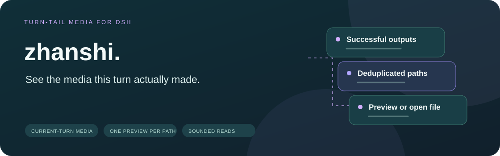
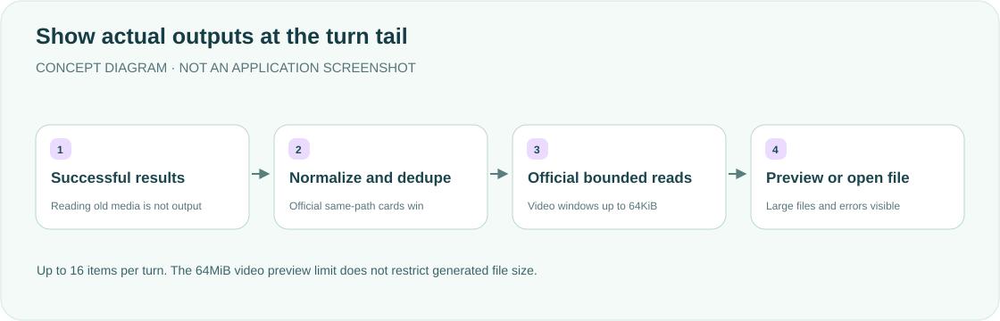

<div align="center">

<h1>zhanshi · See this turn's outputs</h1>
<p><strong>Show saved images/videos at the turn tail.</strong></p>
<p><a href="README.md">简体中文</a> · <strong>English</strong></p>
<p><a href="package.json">v0.1.6</a> · <a href="LICENSE">MIT</a> · DSH desktop plugin</p>
<p><a href="#features">Features</a> · <a href="#how-it-works">How it works</a> · <a href="#installation">Installation</a> · <a href="#collection-rules">Collection</a> · <a href="#file-boundaries">File boundaries</a> · <a href="#validation">Validation</a></p>
</div>

---

Display successful current-turn media, including when an official same-path file card exists. No model-context insertion, generation or replacement of the official renderer. **Reading an old image does not produce a new output.**

## Features

<table><tr>
<td width="33%"><strong>🖼 Turn-tail previews</strong><br/><br/>Open images and play videos with native controls. Render nothing when no media exists.</td>
<td width="33%"><strong>🧭 Ownership and deduplication</strong><br/><br/>Use successful results, cwd and sequence numbers; show each media path once.</td>
<td width="33%"><strong>📁 Bounded reads</strong><br/><br/>Demand-driven256KiB image/video windows; over64MiB becomes open-file UI, without deleting media.</td>
</tr><tr>
<td><strong>🔤 Actual paths</strong><br/><br/>Prefer structured generation results, preserving spaces, quotes and Unicode rather than guessing damaged text.</td>
<td><strong>🛡 Official file services</strong><br/><br/>Use DSH authentication, policy and bounded readers; missing capabilities fail without unrestricted reads.</td>
<td><strong>🧾 Visible failures</strong><br/><br/>Keep failed cards, retry and paths; pending background work or cancellation is never a completed output.</td>
</tr></table>

## How it works



Registered as `zhanshi` in `conversation.chat.turnTail`, beside official delivery cards, not hidden inside tool calls. Historical turns reconstruct previews from events after restart.

## Installation

Clone/copy into `$DSH_HOME/plugins/zhanshi`. Add this item **inside the existing insert list** in `$DSH_HOME/profiles/desktop/cordis.patch.yml`, retaining other entries:

```yaml
- id: zhanshi
  name: ../../plugins/zhanshi/lib/index.js
```

Fully quit DSH with ⌘Q and reopen; refreshing the page does not reload the Host. Uninstall only this entry before another full restart. Host needs connection/fs, Client needs slots/uiConversation; official DSH source stays unchanged.

## Collection rules

- Accept explicit successful present/write/edit and supported generation/screenshot results without structured errors. Explicit local-preview labels from huoqu are supported; read_image means viewing old files, never production.
- Official deliverables.presented and deliverables.produced are both trusted sources, and both file and preview cards remain visible. Official records completed after the closing reply still belong to that Turn. argumentPath aliases normalize relative targets, and Windows drive paths deduplicate case-insensitively.
- Prefer shengcheng_result structured paths, preserving Unicode/quotes/spaces. Damaged structured data fails instead of guessing. Independent legacy `saved …` lines remain supported.
- Nonzero, timed-out, killed, cancelled or still-background bash work is not finished. Only explicit save lines/reliably identified targets qualify, not a compound command's incidental last old file or examples in logs.
- POSIX absolute paths, Windows drive paths and cwd-relative paths normalize and deduplicate. UNC paths, protocol URLs, parent traversal and opaque paths remain rejected. Same filenames in other directories stay distinct.
- Keep only necessary call fields and release call state after processing; lightweight path metadata supports deduplication/counting. Images and videos use HEAD before preview; oversized files show size, retry and open actions. Images use lazy async loading with no referrer; videos preload metadata only.
- Filter node_modules, .git, parent traversal, globs and unsupported extensions. These are product filters, not substitutes for official file permissions.

## File boundaries

<details>
<summary><strong>Authentication, ranges, versions and large files</strong></summary>

Images and videos use relative `/api/zhanshi/file`, including dsh-app:// support. DSH connection handles authentication; the plugin does not rely on the unsupported rev parameter or an extra redirect. Media goes through composed ctx.fs resolve/processPath/stat/readByteRange. Missing bounded APIs return501; no bare Node fs or full-file snapshot fallback, and no decoding opaque target keys.

GET/Range reads demand-driven windows up to256KiB for images and videos. The first window is read before headers, later windows honor backpressure. Unsatisfiable single ranges return416; malformed/multiple ranges fall back to full-file semantics. ETag is SHA-256 of the official version token, **not a content hash**. Only a matching strong If-Range accepts partial output; stale/weak/date values fall back. HEAD ignores Range and reads metadata only.

Each window checks version/size before and after reading. Short reads, growth or replacement fail with409/404 before headers or a body-stream error afterward, rather than mixing file versions. This is not a descriptor-held immutable snapshot or malicious-process race guarantee. Request/consumer cancellation interrupts provider I/O and releases listeners/windows; permission, missing-file, size and I/O errors stay visible.

**64MiB is the image and video preview limit, not a generation limit.** shengcheng may save256MiB video. Larger previews return413 with X-Zhanshi-Preview:open-file, X-Zhanshi-File-Size and X-Zhanshi-Preview-Limit. Client HEAD displays actual size, limit, retry and open actions without raising memory limits or deleting media. Permission/404/500 HEAD failures remain retryable. External opening requires Host openFile; absent capability retains a path/link, not a claim that an app opened. Bounded windows still have provider/concurrency overhead, not zero-copy guarantees.

</details>

## Validation

lib/core.js is the only parser/state source. scripts/build-client.mjs embeds it into lib/client.template.js and generates the self-contained lib/client.js; npm run check rejects stale generated output. A complete read-only extracted official installation is required. Missing DSH_OFFICIAL_ROOT/packages fails without skip/old-checkout fallback. Fixtures write only random temporary media and import official source read-only.

```bash
export DSH_OFFICIAL_ROOT=/absolute/path/to/extracted-official-runtime
node scripts/build-client.mjs
npm run check
npm test
```

<details>
<summary><strong>Historical checks—not current desktop acceptance</strong></summary>

2026-11-10:163/163 regressions cover the shared parser and shipped Client reducer, the full match/start/update event path, ImageMagick input rejection, joined curl/wget options, tee, huoqu, Windows drive paths, official presented/post-closing deliveries, argumentPath deduplication, replacement results, image/video HEAD 413, lazy loading and256KiB windows. Official filesystem fixtures check read-only ranges and large HEAD responses; controlled providers cover backpressure, cancellation, file changes and errors. An isolated real Chrome/React18.3.1 smoke test also passed with the unified media route, lazy image attributes, official-present and independent previews, large-video downgrade/open and unmount, with no `/api/file` requests or page errors.

An isolated Chrome/React18.3.1 smoke test covered synthetic requests and actual source, not a reloaded desktop. scripts/browser-smoke.mjs requires explicit existing DSH_PLAYWRIGHT_MODULE, DSH_REACT_UMD, DSH_REACT_DOM_UMD and DSH_BROWSER_EXECUTABLE; missing values fail without installing dependencies. Earlier0.1.3 records report136/136 tests and five official-reader file checks. Detailed records remain in the [Chinese README](README.md).

</details>

**This update reruns the complete product suite and bilingual documentation. No paid media was generated. Real desktop preview acceptance is separate and cannot be replaced by unit tests.** Historical component/browser fixtures are not current desktop acceptance.

[MIT License](LICENSE).

<div align="center"><sub>Show real outputs. Keep failures visible. · <a href="README.md">阅读中文版 →</a></sub></div>
