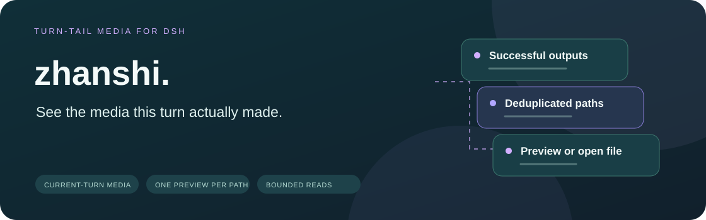
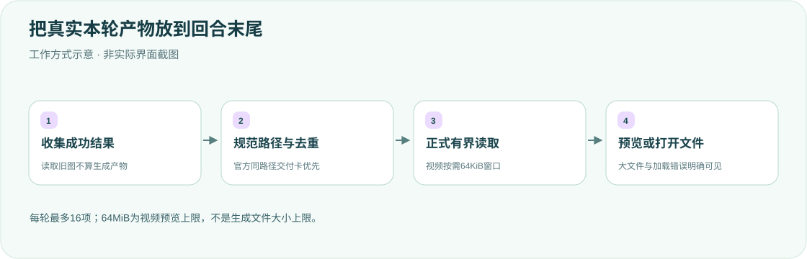

<div align="center">

<h1>zhanshi · 让本轮产物看得见</h1>
<p><strong>把成功保存的图片和视频放到回合末尾，不重复官方交付卡。</strong></p>
<p><strong>简体中文</strong> · <a href="README.en.md">English</a></p>
<p><a href="package.json">v0.1.3</a> · <a href="LICENSE">MIT</a> · DSH desktop plugin</p>
<p><a href="#核心能力">核心能力</a> · <a href="#工作方式">工作方式</a> · <a href="#安装与生效">安装与生效</a> · <a href="#收集和展示规则">收集规则</a> · <a href="#文件读取和边界">文件边界</a> · <a href="#开发与验证">验证</a></p>
</div>

---

只展示本轮成功保存或明确交付、且没有官方同路径卡的媒体。不写入模型上下文、不生成媒体、不替换官方渲染器。**读取旧图片不是本轮产物。**

## 核心能力

<table><tr>
<td width="33%"><strong>🖼 回合末尾预览</strong><br/><br/>图片可打开，视频有原生控件，没有媒体时不渲染。</td>
<td width="33%"><strong>🧭 本轮归属与去重</strong><br/><br/>按实际成功结果、cwd与序号识别，官方同路径交付卡优先。</td>
<td width="33%"><strong>📁 有界读取</strong><br/><br/>视频按需64KiB窗口读取；超64MiB明确改为打开文件，不删除媒体。</td>
</tr><tr>
<td><strong>🔤 真实路径</strong><br/><br/>优先结构化生成结果，保留空格、引号及Unicode，不用损坏文本假装成功。</td>
<td><strong>🛡 正式文件服务</strong><br/><br/>沿用DSH认证、权限和有界reader，缺失能力报错，不裸读绕过。</td>
<td><strong>🧾 可见的失败</strong><br/><br/>加载失败保留卡片、重试及路径；不把后台未完成或取消当成产物。</td>
</tr></table>

## 工作方式




预览以 `id: zhanshi` 注册到 `conversation.chat.turnTail` 列表，与官方交付卡同层，不会折进工具调用列表。图片可点击打开，视频使用原生播放控件；没有媒体时不渲染。

## 安装与生效

包位于 `$DSH_HOME/plugins/zhanshi`。在 `$DSH_HOME/profiles/desktop/cordis.patch.yml` 的 `insert` 中加入：

```yaml
- id: zhanshi
  name: ../../plugins/zhanshi/lib/index.js
```

修改后必须完全退出 DeepSeek Harness（macOS：⌘Q）再打开；仅刷新页面不会重新加载 Host。重启后的历史回合可从事件重新构建预览。卸载时去掉该 insert，再完全退出并重开。

Host 依赖 `connection`、`fs`；Client 依赖 `slots`、`uiConversation`。不修改官方 DSH 源码，不替换官方对话渲染器。

## 收集和展示规则

- 只收集本轮明确成功且无结构化错误的 `present`、`write`、`edit`、支持的媒体生成/截图工具结果；`read_image` 只表示查看旧文件，不进入产物区。
- 官方 `deliverables.presented` 已承担同路径文件卡时，本插件按 cwd 规范化并去重；只抑制当前 closing seq 之前的官方卡，不抑制尚未 materialize 的 present、独立生成图、其他目录同名媒体。官方 produced 仍可作为真实本轮产物来源。
- `shengcheng_result` 的结构化路径优先，完整保留空格、引号及 Unicode；结构化记录损坏时不以模糊文本兜底伪装成功。兼容旧的独立 `saved …` 行。
- bash 非零退出、超时、终止、取消或仍在后台运行时不当作完成。只识别明确保存行和可可靠识别的写入目标；不把复合命令最后出现的旧文件当作目标，不解析会话日志里的示例。
- 相对路径按会话 cwd 解析后规范化、去重；不同目录同名文件仍分别展示。同路径保留最新序号，刷新对应预览地址。
- 每回合显示最多 16 项，优先明确交付的成品，再显示较新的其他媒体；超过上限时显示剩余数量，不把中间图无提示地排在最终成品之前。此限制只影响本插件预览，不删除官方交付记录。
- 媒体调用只保留解析所需字段，处理结果后释放调用状态；无关工具不进入该状态。媒体记录保留轻量路径信息用于去重及溢出统计。
- 图片、视频加载失败时保留可见文件卡，提供重试和打开操作；视频使用 `preload="metadata"`，不主动预加载全部内容。
- 忽略 `node_modules`、`.git`、父目录跳转、glob 和不支持的扩展名；这些是产品过滤规则，不替代官方文件权限控制。

## 文件读取和边界

图片使用官方 `/api/file`，视频使用 `/api/zhanshi/file`。两者都是相对 URL，以兼容桌面 `dsh-app://`。认证由 DSH connection 处理；本插件不绕开认证。

视频路由通过 composed `ctx.fs` 的 `resolve`、`processPath`、`stat`、`readByteRange` 执行路径解析与读取；最后一个是正式有界二进制接口，sandbox provider 继承提供。禁止直接用本机 Node fs 或整文件快照兜底绕过 provider；缺少正式能力明确返回 501。规范目标路径也必须满足媒体和目录过滤规则，不解析不透明 target key。

- 视频 GET/Range 按 demand 用 `readByteRange` 读取最多 **64 KiB** 窗口，首窗在发送 headers 前读取以暴露权限/I/O 错误，之后保留 backpressure，不读取区间外内容。不可满足的单区间返回 416，格式错误/多区间忽略并返回整文件。
- ETag 为官方版本 token 的 SHA-256，不冒称内容哈希；本地正式 token 含文件身份、大小、纳秒 mtime/ctime。`If-Range` 只接受匹配强 ETag；旧/弱标签或日期退回整文件。HEAD 忽略 Range，只取元数据，返回一致 ETag 和大小。
- 每窗前后检查同一版本和大小，短读/增长/替换明确失败；首窗前失败返回 409/404，发送 headers 后的变化使 body stream 报错，而非静默拼接不同文件。不是持有同一描述符的不可变快照，不宣称抵御恶意本地进程隐藏版本变化的竞态。
- 请求取消和 body consumer cancel 会中止正在执行的 provider I/O、释放监听及窗口；文件不存在、权限拒绝、超限、取消和 I/O 错误不会伪装成功。
- **64 MiB 是预览产品限制，不是生成限制。** shengcheng 可保存至 256 MiB 视频；超过预览上限，HEAD/GET 返回 413 和明确 `X-Zhanshi-Preview: open-file` / `X-Zhanshi-File-Size`。Client 用 HEAD 区分大文件，显示实际 MiB 与「打开文件」，不提高内存上限、不会删掉已保存媒体。HEAD 权限/404/500 仍可见错误并支持重试。

**开销与保证范围：** 已删除旧的全文件快照/内容哈希实现；Range 不再为几字节请求读完/哈希整个文件。每次 demand 只读取一个有界窗口，provider 内部缓冲与并发请求仍有开销，不宣称零拷贝。大视频的打开动作依赖 Host 提供的 `openFile`；没有该能力时保留文件路径和普通文件链接，不能宣称外部程序已打开。

## 开发与验证

正式 FS 集成测试要求完整、只读的官方安装包提取目录；缺少 `DSH_OFFICIAL_ROOT` 或包文件明确失败，不跳过、不退回旧 checkout。只在随机临时 fixture 写入媒体，官方源码只 import，不修改。

```bash
export DSH_OFFICIAL_ROOT=/absolute/path/to/extracted-official-runtime
for file in lib/*.js; do /usr/local/bin/node --check "$file" || exit; done
/usr/local/bin/node --test
```

2026-10-12 修复：143/143 完整回归通过，实际 Client reducer/Gallery/HEAD effect 执行验证 read_image 非产物、官方 present 同路径去重、256 MiB 降级/打开、403/404/500 可见、dispose 取消。正式 `SandboxPolicyService` + `SandboxedFileSystem` 验证 read-only Range、替换后 If-Range、256 MiB HEAD 413；受控 provider 验证单窗 backpressure、consumer cancel 中止 in-flight IO、增长/缩小/删除/版本错误。参考读、二进制窗与交付去重均记录修复前失败、修复后通过。不读取真实凭据、不生成付费媒体、不重启桌面，未执行新版本真实桌面 UI 验收。

同日通过实际 Chrome + React 18.3.1 隔离 DOM 烟雾测试：读取旧图为空、官方 presented 同路径去重而独立图片仍显示、图片打开路径、256 MiB HEAD 降级/打开、unmount，零 page error。仅拦截 `fixture.invalid` 本地合成请求，不新建服务器、不操作用户正在使用的 GUI。运行 `scripts/browser-smoke.mjs` 需显式设置现成只读依赖 `DSH_PLAYWRIGHT_MODULE`（Playwright index.mjs）、`DSH_REACT_UMD`、`DSH_REACT_DOM_UMD`、`DSH_BROWSER_EXECUTABLE`；缺少会失败，不安装依赖。这是独立浏览器替代检查，仍不等于 desktop 已重载新实现。

0.1.3 修复验证（2026-10-07）：136/136 回归通过；安装包官方 reader 函数配合真实临时文件的 5 项增长、缩小、删除、符号链接和取消检查通过；独立 Chrome + React 18 夹具加载实际 Client/Host，验证去重、交付优先、溢出、失败/重试/打开、视频播放和拖动、桌面/手机宽度及空状态。夹具文件服务采用受控 provider，图片接口模拟官方接口，不代表连接了已重启的桌面运行实例。

**待运行态验收：** 历史修复没有关闭正在使用的 DSH。单元测试或独立浏览器夹具不是桌面重启后的真实验收；完全退出并重开后，仍需在实际会话确认新插件加载及图片、视频展示。

<details>
<summary><strong>大视频为什么显示「打开文件」？</strong></summary>

64MiB只是插件视频预览上限，不是生成或保存上限。较大媒体仍留在原路径，插件不为预览扩大整文件内存，也不删除已经成功保存的文件。

</details>

**本次仅更新双语文档和原创图示，检查链接及桌面/手机排版；未重跑产品测试、未生成付费媒体或重启 DSH。** [MIT License](LICENSE)。

<div align="center"><sub>展示真实产物，保留真实错误。 · <a href="README.en.md">Read in English →</a></sub></div>
